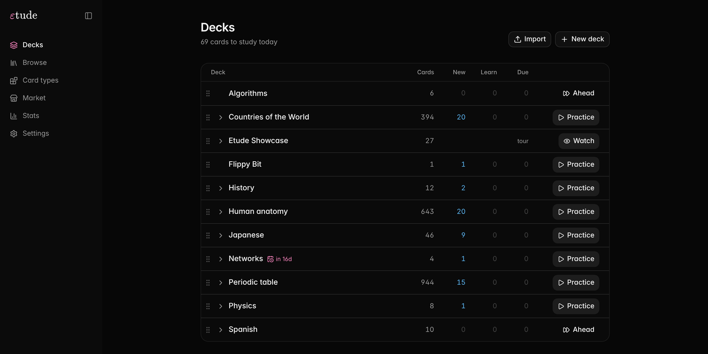
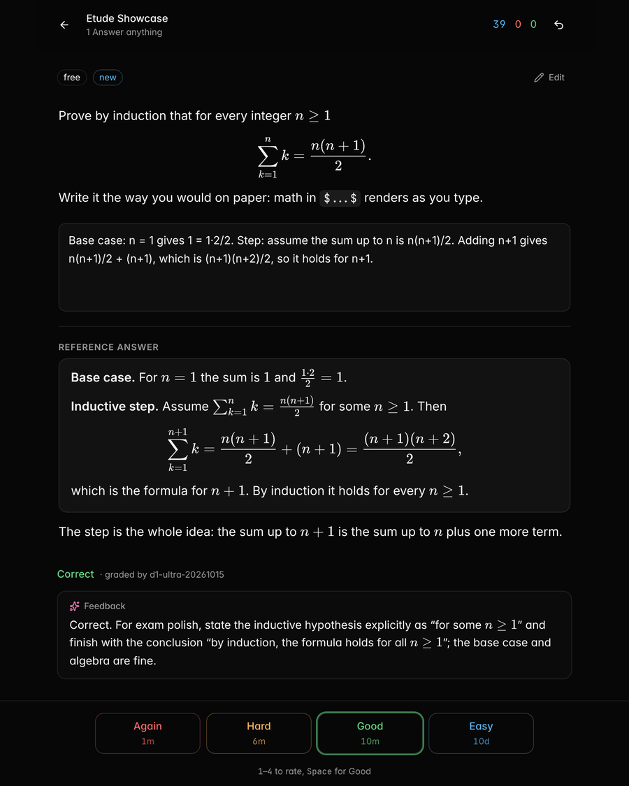
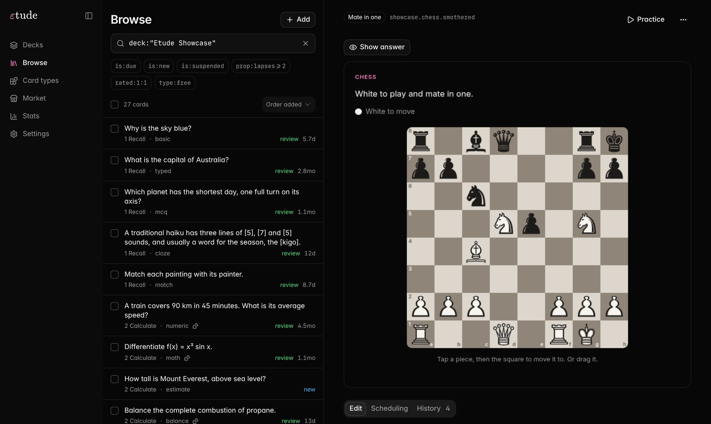
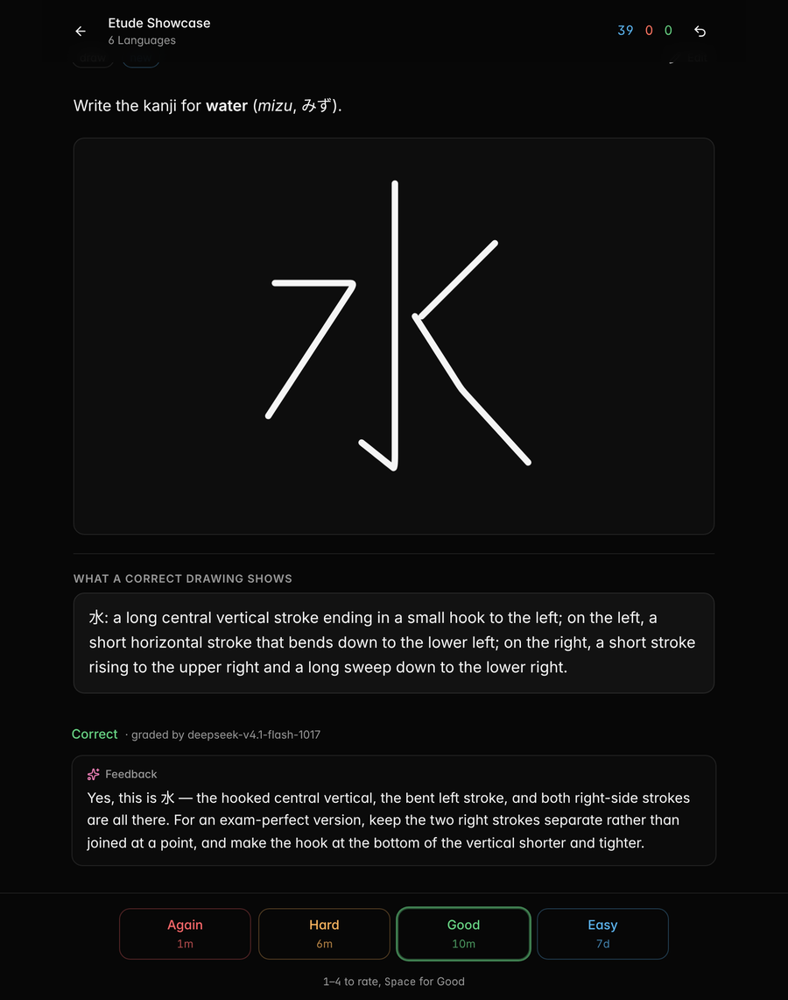
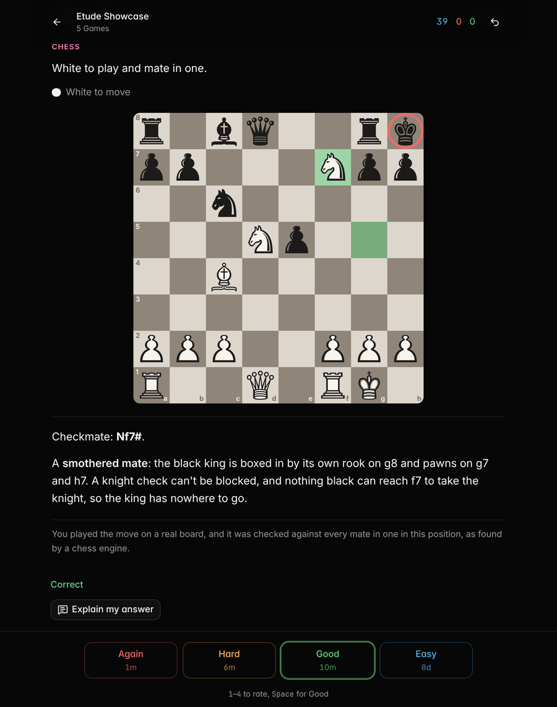
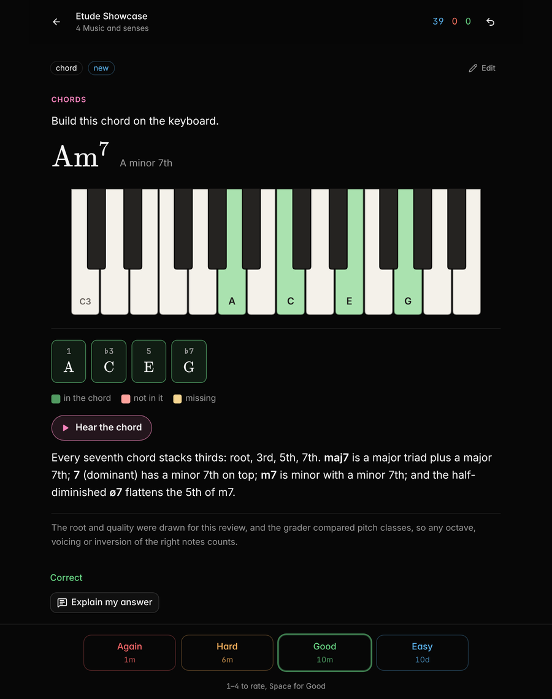
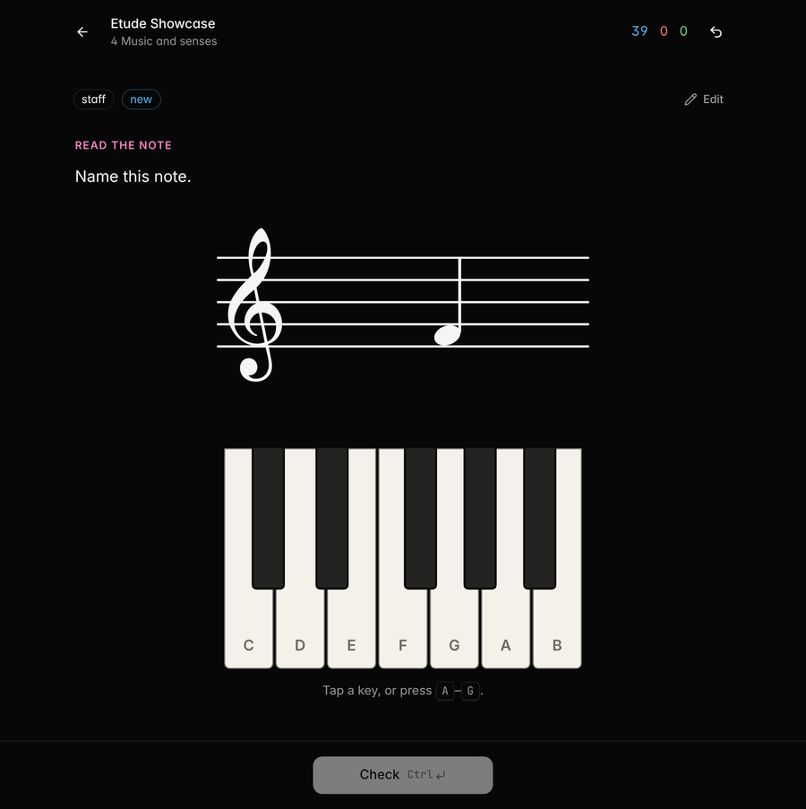
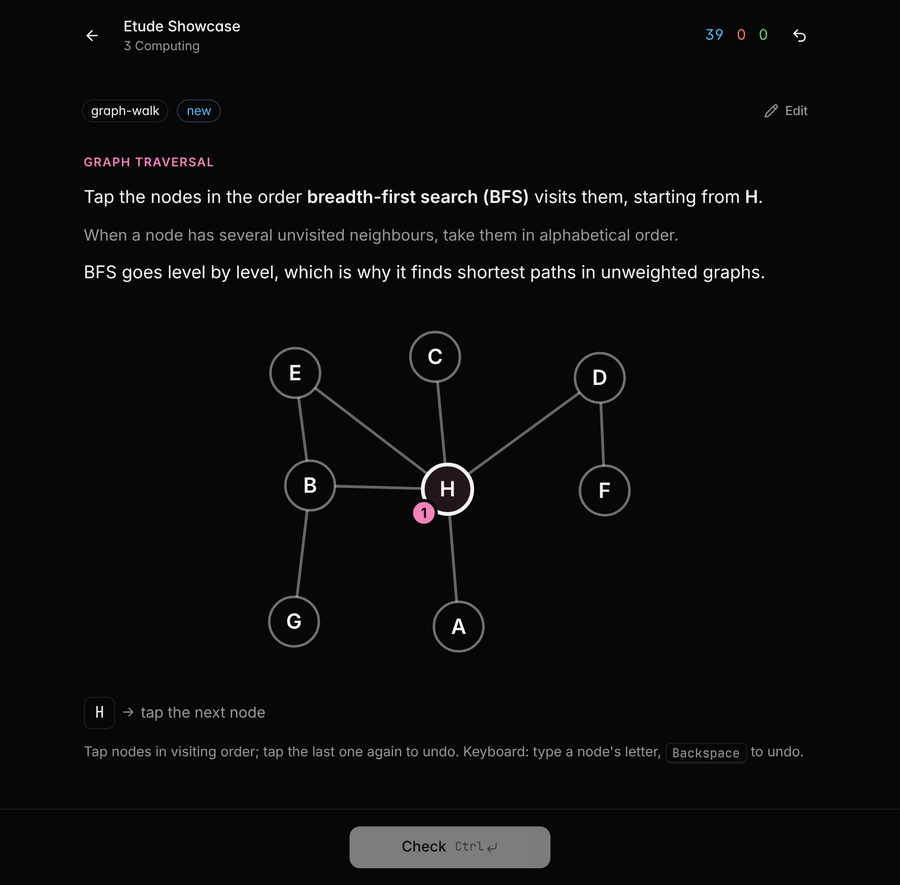
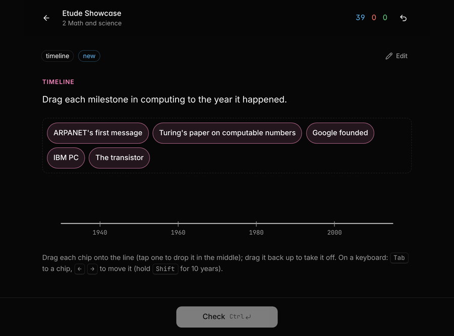

# εtude

**Flashcards that can be anything a web page can be.**

Etude is a self-hosted spaced-repetition app where every card type is a small program. A card can give you fresh numbers to compute on every review, ask you to drag events onto a timeline, play a chord on a piano, find the checkmate on a real board, write a proof that renders as you type, or draw a diagram that a vision model grades. Open answers are graded by AI, which tells you exactly what you missed. Scheduling is FSRS-6, with exam deadlines that make sure everything gets reviewed before the day. And every action in the app is also a CLI command with JSON output, so an AI agent can build your decks, quiz you in a chat and find your weak spots.







## Why another flashcard app

Classic flashcards test recognition: you see the front, think of the back, flip the card and judge yourself. That works for vocabulary. It works badly for most of what people actually study, where the skill is doing something: computing, deriving, tracing an algorithm, explaining why. Etude keeps what makes spaced repetition work and changes what a card is.

| | Classic flashcard apps | Etude |
|---|---|---|
| What a card is | A front and a back | A program: template, script and grader |
| Who grades it | You | You, a script, AI, or a script that hands hard cases to AI |
| Calculation practice | Same numbers every time, so you end up memorizing the answer | A generator makes a new variant every review |
| Open answers | You compare with the back | An AI verdict plus a few sentences on what was missing |
| Math answers | Shown, never checked | Typed with live rendering, graded by equivalence (`x(x+1)` = `x^2+x`) |
| Exam dates | Intervals ignore them | A deadline pulls every card in before the exam |
| Automation | Add-ons, or editing the database | Every action is a CLI command with JSON output |

## What a card can be

Every card below is a real card type from the [showcase pack](examples/showcase/), screenshotted after answering it. Each one is a folder of HTML, CSS and JavaScript you can open and change, and each is graded by something that actually checks the work.

<table>
<tr>
<td width="50%" valign="top">
<p><b>Write kanji by hand.</b> Draw the character with a mouse, pen or finger. A vision model reads your strokes against a description of the character and tells you what to fix.</p>

</td>
<td width="50%" valign="top">
<p><b>Solve chess puzzles on a real board.</b> Tap or drag the move. The answer is checked against the engine-verified list of mates, so any correct move counts.</p>

</td>
</tr>
<tr>
<td width="50%" valign="top">
<p><b>Play chords on a piano.</b> A new root and quality every review. Any voicing or inversion counts, because the grader compares pitch classes. Hear your chord and the right one.</p>

</td>
<td width="50%" valign="top">
<p><b>Read music.</b> A new note on the treble or bass staff every review, ledger lines and accidentals included. Answer on the keyboard or with the letter keys.</p>

</td>
</tr>
<tr>
<td width="50%" valign="top">
<p><b>Trace algorithms.</b> Tap the nodes of a generated graph in the order BFS or DFS visits them. The real traversal animates afterwards.</p>

</td>
<td width="50%" valign="top">
<p><b>Place history on a timeline.</b> Drag events between fixed anchors. Graded by order and by how many years each one is off.</p>

</td>
</tr>
</table>

The pack also has ear training (name the interval you hear), regexes with live tests, spotting the buggy line in a listing, binary and two's complement switches, the unit circle, points on a graph, balancing chemical equations, colors from hex codes, Fermi estimates on a log slider and 30-second arithmetic sprints. Import it and try them all:

```sh
etude pack import examples/showcase.pack.json
```

## What you can do with it

- **Prepare for an exam.** Put the course in a deck, set the exam date as its deadline and study every day. No card is scheduled after the deadline, and cards you already know still get one last look before it. The Stats page forecasts how many reviews are left each day until then.
- **Practise calculations instead of memorizing answers.** A numeric item can carry a generator, so "the transmission delay of an L-byte packet on an R Mbps link" comes back with different numbers every time. The seed is stored with each review, so any variant can be reproduced.
- **Explain things in your own words.** Free-answer cards are graded against a reference answer and a rubric. You get a verdict and two to four sentences on what was missing and how to fix it, in the language of the card.
- **Write math and code the way you would on paper.** Answer fields are live Markdown editors, like Obsidian: `$math$`, code blocks and formatting render as you type, so a derivation can be the answer. Code cards have a real editor with highlighting for about 140 languages, and JavaScript answers run against hidden tests in a sandbox.
- **Draw your answer.** Write kanji or hanzi by hand, sketch a graph, a circuit or a molecule, and a vision model grades it.
- **Learn skills that aren't text.** Music, chess, algorithms and history become cards you play, move, tap and drag, as in the gallery above. If the skill you want isn't there, a card type is a web page, so you can build it.
- **Let an agent make your cards.** Give an agent your notes and the bundled [skill](skill/SKILL.md). It writes a pack, validates it with `etude pack check`, imports it, and later reads `etude stats weak` to see which topics you keep failing.
- **Get quizzed in a chat.** An agent can run a study session without the web app: `etude study next` returns the card and how to answer it, and `etude study answer` grades and schedules it.
- **Study from anywhere on your own server.** Run Etude on your computer and open it from your phone or tablet; the layout is made for phones too. A compact study view at `/embed` fits inside other apps.

## Features

- **Programmable card types.** Eleven built-in types ship as editable files: basic, typed answer, cloze, numeric, multiple choice, match, order, free answer, math, code and drawing. Custom types are written the same way and edited in the app with a live preview.
- **Four kinds of grader.** `self` (you rate), `script` (checked by code, with partial credit), `ai` (a decision model plus feedback) and `hybrid` (a script that hands the cases it can't decide to the AI). Grading instructions cascade from the item's rubric through its tags, decks and type.
- **AI providers you choose.** The defaults use OpenRouter: `liquid/d1-ultra` for the verdict, a fast chat model for feedback and a vision model for drawings. Any OpenAI-compatible endpoint works, including a local llama.cpp or Ollama server. AI stays off until you add a key.
- **FSRS-6 scheduling** with learning steps, fuzz, per-deck daily limits, new and review ordering, sibling burying, a suggested rating from the grade, undo, and replaying history after a settings change.
- **Settings that inherit down the deck tree.** A preset on `Physics` applies to `Physics::Waves` unless that deck overrides it.
- **Exam deadlines** per deck.
- **A search language** for Browse, filtered study sessions and the CLI.
- **Packs.** One JSON file carries decks, presets, tags, card types and items. Import is idempotent and keeps review history.
- **Statistics:** card states, true retention, a review heatmap, the forecast up to a deadline and recall per tag.
- **Themes:** five built in (three dark, two light), or your own with CSS variables and extra CSS.
- **A complete CLI** with more than 100 commands, stable JSON output, a machine-readable catalog (`etude commands`) and a dry run on most commands that change data.
- **Import from Anki.** `.apkg` and `.colpkg` files bring their notetypes, decks, tags, media and review history across; see [docs/anki.md](docs/anki.md).

## Quick start

Etude needs Node 24 or newer. Node runs the TypeScript sources directly, so the server has no compile step.

```sh
git clone https://github.com/Zibhelina/etude.git
cd etude
npm install
npm run build        # builds the web app into web/dist
npm start            # same as: node src/cli/main.ts serve
```

Open http://127.0.0.1:4610. Your collection lives in `~/.etude/etude.db`.

To see what cards can be, import the showcase, where every card is a different kind of exercise:

```sh
node src/cli/main.ts pack import examples/showcase.pack.json
```

`npm link` puts the `etude` command on your path, so `etude serve` and `etude pack import file.json` work from anywhere.

### Turn on AI grading

Put a key in `~/.etude/.env` and restart the server:

```sh
OPENROUTER_API_KEY=sk-or-...
```

Settings → AI grading has presets for OpenRouter, OpenAI and a local server, plus a button that grades a sample answer to test the setup. [SECURITY.md](SECURITY.md) lists exactly what is sent to the provider.

### Use it from your phone

By default the server only listens on your own computer. To reach it from other devices on your network, give it a token:

```sh
etude serve --host 0.0.0.0 --token "$(openssl rand -hex 16)"
```

Open `http://<your-computer>:4610/?token=<token>` on the phone and add it to the home screen. For access away from home, use a private network such as Tailscale, or a reverse proxy with TLS.

## Configuration

| | |
|---|---|
| `~/.etude/.env` | API keys, one per line, e.g. `OPENROUTER_API_KEY=...`. Read at startup. Keys are never stored in the database or shown in the app. |
| `--db PATH` or `ETUDE_DB` | Collection file. Default `~/.etude/etude.db`. Drawings and attachments are saved in a `media/` folder next to it. |
| `ETUDE_HOME` | Where `.env` and the default database live. Default `~/.etude`. |
| `--port` or `ETUDE_PORT` | Default 4610. |
| `--host` or `ETUDE_HOST` | Default `127.0.0.1`. Any other address requires a token. |
| `--token` or `ETUDE_TOKEN` | Every `/api` request must then send `Authorization: Bearer <token>` or `?token=<token>`. |

AI providers, the feedback language, when feedback is written automatically, the hour a new study day starts and the learn-ahead limit are set on the Settings page or with `etude settings`.

## Packs

A pack is one JSON file. Every key except `etude` is optional, and decks named by items are created as needed.

```json
{
  "etude": "pack/1",
  "name": "Networks",
  "decks": [{ "name": "Networks", "instructions": "Accept answers in ms or s if the conversion is right." }],
  "items": [
    {
      "id": "net.dtrans-1",
      "type": "numeric",
      "deck": "Networks::Delay",
      "fields": { "prompt": "A 1,500-byte packet on a 10 Mbps link. Transmission delay?", "answer": 1.2, "unit": "ms" }
    },
    {
      "id": "net.why-packets",
      "type": "free",
      "deck": "Networks::Switching",
      "fields": {
        "prompt": "Why can packet switching serve more users than circuit switching on the same link?",
        "reference": "Users are idle most of the time, so the link is shared statistically instead of reserving capacity per user.",
        "rubric": "Must mention that users are not all active at once."
      }
    }
  ]
}
```

Import it from the Decks page, Settings → Data, or a terminal:

```sh
etude pack check networks.pack.json            # validate every item, including generated variants
etude pack import networks.pack.json --dry-run # report what would change
etude pack import networks.pack.json
etude pack new starter.pack.json               # one working item of each built-in type, to edit
```

Items are matched by `id`, so importing an edited pack updates the content and keeps the scheduling. [docs/packs.md](docs/packs.md) documents the format, generators and the fields of every built-in type.

## Card types

A card type is a folder: `type.json` (fields and grader), `template.html`, `style.css`, `card.js` (runs in the card's frame), an optional `prepare.js` (turns stored fields into what the card shows and keeps the answer key out of the frame) and an optional `grade.js`. The built-in types in [`types/`](types/) and the showcase types in [`examples/showcase/types/`](examples/showcase/types/) are the best examples.

```sh
etude type export mcq -o mcq/     # a type as editable files
# edit them
etude type import mcq/            # create or update the type
```

The Card types page does the same in the browser, with an editor and a live preview. [docs/types.md](docs/types.md) is the full reference.

## Scheduling

Cards are scheduled with FSRS-6 (via [ts-fsrs](https://github.com/open-spaced-repetition/ts-fsrs)). Settings come in layers: the defaults, then for each deck from the root down, its preset and its own overrides. Retention, learning steps, limits, ordering, FSRS weights and how scores turn into suggested ratings are all set per layer.

A deck can have an exam `deadline`. No card in it is scheduled after the deadline minus a margin (12 hours by default). A card that would come back later is pulled in, usually to halfway between now and the deadline, so even a well-known card gets one more look. After changing retention, steps or a deadline, `etude card reschedule --deck NAME` replays the review history with the new settings; the deck page offers the same when you save such a change.

## Search

The same language works in Browse, in filtered study sessions and in `etude search`:

```
deck:"Networks"       the deck and everything below it      (deck:net* wildcards)
tag:net::w1           the tag and every tag below it        (tag:exam::* wildcards)
type:numeric  id:net.w1.*  source:ch1
is:new is:learning is:review is:relearning is:due is:suspended is:buried is:archived
prop:lapses>=2  prop:reps=0  prop:stability<3  prop:difficulty>7  prop:due<=1 (days from now)
rated:1  rated:7:1    reviewed in the last N days (optionally with that rating)
word  "a phrase"      text anywhere in the item's fields
-term  a OR b  (grouping)   implicit AND between terms
```

## CLI for people, scripts and agents

```
etude <group> <verb> [args] [flags]

  deck      the tree, settings inheritance, presets, descriptions and grading instructions
  preset    named settings shared by several decks
  item      the content behind one or more cards
  card      per-card scheduling: suspend, bury, reset, due dates
  tag       hierarchical labels, with grading instructions
  type      card types: fields, template, prepare script and grader
  study     the queue, presenting a card, submitting answers, ratings, undo
  stats     overview, forecast, recall per tag, weak cards
  settings  AI providers and models, day start, learn-ahead
  theme     app colors and custom CSS
  pack      import, export, check, new
  db        backups, integrity, schema version

  serve     run the web app and HTTP API
  search    find cards with the search language
  commands  every command as JSON: args, flags, defaults, examples, whether it writes
```

Output is JSON on stdout. Errors are `{"error", "code"}` on stderr with a distinct exit code for each kind. Most commands that change data accept `--dry-run`. [docs/cli.md](docs/cli.md) has recipes (build a deck from notes, quiz someone in a chat, set an exam deadline, find and suspend leeches) and the full reference.

Agents that use Etude should read [skill/SKILL.md](skill/SKILL.md). It can be dropped into an agent's skills folder as is.

## Architecture

```
src/core/     the engine, no HTTP: data model and SQLite store (node:sqlite), FSRS scheduler,
              search compiler, QuickJS sandbox for user scripts, AI grading, packs
src/server/   Hono HTTP API, card frame documents, static files for the web app
src/cli/      the etude command
runtime/      runtime.js and card.css, loaded inside every card frame
types/        the built-in card types, one folder each
web/          React, Tailwind and shadcn/ui app (Vite)
examples/     showcase.pack.json (built from examples/showcase/ with `node examples/showcase/build.ts`)
skill/        the agent skill for using Etude
docs/         packs, card types and the CLI reference
test/         node:test suites
```

The web app and the CLI are thin layers over one engine class, so they can't drift apart.

## Security

Card code runs in sandboxed iframes with an opaque origin, user scripts run in QuickJS on the server, and the server only listens on localhost unless you set a token. [SECURITY.md](SECURITY.md) explains the trust model, what AI grading sends and how to report a vulnerability.

## Contributing

See [CONTRIBUTING.md](CONTRIBUTING.md). Bug reports and new card types are very welcome.

## License

[MIT](LICENSE)
